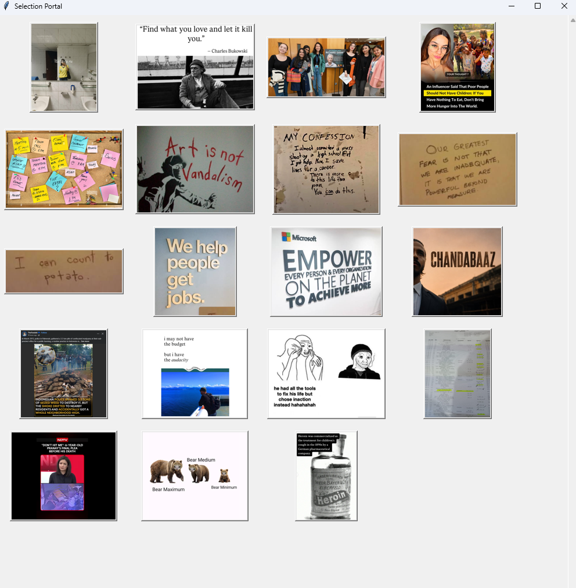
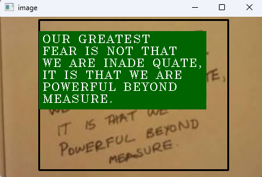
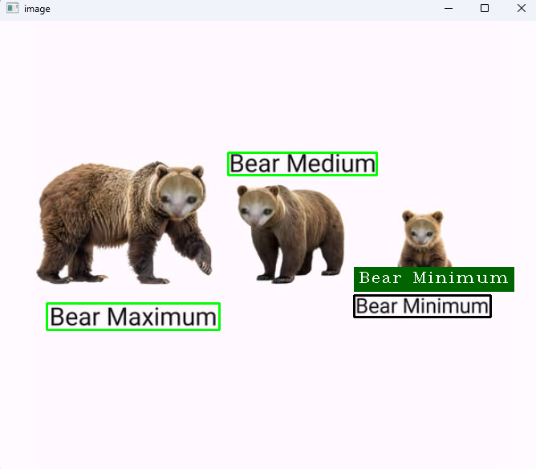

# ImageOCR
A Python-based OCR application that extracts and displays text from a directory of images. 
Run detection for an image, detected text will be shown when hovered over the area of text and can be copied with pressing "c" while hovered. 

## Features
- **Image selection portal:** Displays images from a directory as a gallery.
- **Text recognition:** Uses PaddleOCR to detect and recognize English text in images.
- **Text segmentation:** Clusters text lines together, making it a single block.
- **Text preview:** Displays the recognized text when hovered over.
- **Clipboard interaction:** A segment can be copied by hovering over and pressing "c".

## Demo




## Requirements
- Python 3.10 or later
- PaddleOCR
- OpenCV
- NumPy
- Pillow
- Pyperclip
- Tkinter

  
## Installation

1. Clone the repository:

   ```bash
   git clone https://github.com/siam-saharear/ImageOCR.git
   cd ImageOCR
   ```

2. Create and activate a virtual environment:

   **Windows**
   ```bash
   python -m venv .venv
   .venv\Scripts\activate
   ```

   **Linux**
   ```bash
   python3 -m venv .venv
   source .venv/bin/activate
   ```

3. Install the dependencies:
   ```bash
   pip install paddleocr opencv-python numpy pillow pyperclip
   ```

## Project Structure
```text
ImageOCR/
├── main.py
├── utils.py
├── segmentation.py
├── media/
│   └── input/
│       ├── image_1.png
│       ├── image_2.png
│       └── ...
└── README.md
```


## Usage
1. Place your images inside `media/input/`.
2. Run the application:
   ```bash
   python main.py
   ```
3. Select an image from the gallery.
4. Move your mouse over the detected text segment you want to copy.
5. Press "c".

## Keyboard Shortcuts 
`C`  Copy targeted segment
`Q`  Close the current image window 
`Q`  Close the image selection portal 


## Future Improvements
- Improve text segmentation for complex layouts.
- Add mouse-click selection and copying.
- Recognize and categorize text based on font, color or any other features.   
